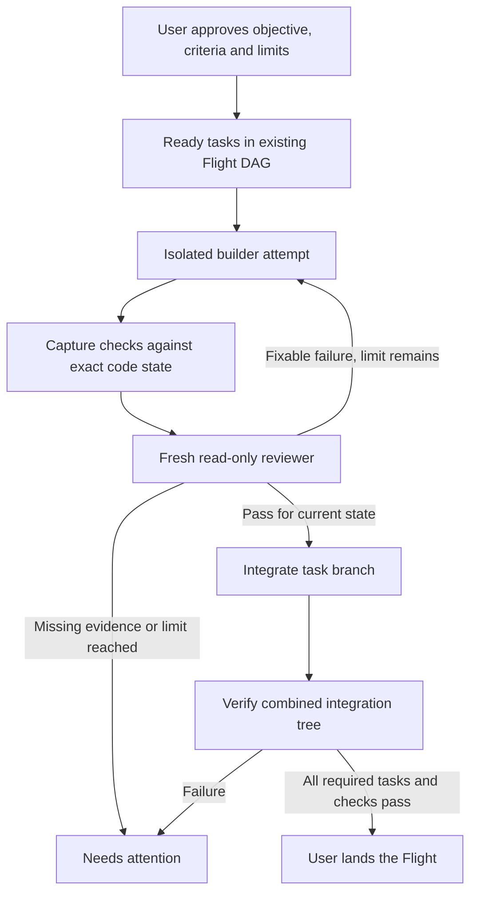

# Loop and graph engineering alignment for PacketBench

Research date: 2026-10-19. Source baseline: `4698ca9c4ce848e4cfe6ddfb0648ea360256ef5e`
(0.14.9); working tree clean at scan start. Status: research and proposed
follow-ups, not approval to expand autonomy or start a new implementation.

PacketBench already implements much of the useful architecture described by
loop and graph engineering: isolated attempts, an independent reviewer,
cooperative task dependencies, persisted policy snapshots, and an opt-in
feedback runtime. The next useful step is to prove and harden those paths,
especially the evidence used to accept a result. A new scheduler or visual
graph editor would add less value at this stage.

## What the sources actually establish

The June 10 [New Stack article](https://thenewstack.io/loop-engineering/)
identifies Boris Cherny as **head of Claude Code**, rather than head of all
development at Anthropic. It reports his statement, “my job is to write loops.”
[WorkOS's June 2 event recap](https://workos.com/blog/boris-cherny-claude-code-acquired-interview-takeaways)
independently describes him building workflows that prompt Claude. The recap
supports the idea; the full interview video could not be inspected here, so
the longer viral quotation is not treated as a verified transcript.

[Addy Osmani's June 7 essay](https://addyosmani.com/blog/loop-engineering/)
provides the broader loop-engineering framing: assemble discovery, execution,
verification, and continuity so the human need not supply each next prompt.
It also warns about token costs and losing understanding of the code. This
is commentary about an emerging practice, not an Anthropic specification.
Its product-feature comparisons are not requirements for PacketBench.

The supplied [Anatoli Kopadze post](https://x.com/AnatoliKopadze/status/2080668775796314331)
is titled “Graph Engineering explained: what it is, when to use it and when
not to.” X did not return readable original content. The
[attributed English reproduction](https://etelv.cl/articulo/graph-engineering-explained-what-it-is-when-to-use-it-and-when-not-to)
was used to understand the proposal: remove dependencies that carry no actual
input, run independent jobs together, validate outputs, and account for
missing branches at the join. Its emphasis on real evidence and fixed rules
is useful. Its speed claims, large-agent anecdotes, and suggestion that a
particular prompt word reliably activates a fleet are not established
engineering guarantees.

Primary technical support is older and more precise:

- Anthropic's [Building effective agents](https://www.anthropic.com/engineering/building-effective-agents)
  (December 19, 2024) already distinguishes chaining, routing, parallelization,
  orchestrator/workers, and evaluator/optimizer workflows. A graph describes
  dependencies and branching; feedback loops can operate within that structure.
- [Effective harnesses for long-running agents](https://www.anthropic.com/engineering/effective-harnesses-for-long-running-agents)
  (November 26, 2025) emphasizes incremental work, structured progress,
  recoverable git state, and actual end-to-end checks across sessions.
- [Harness design for long-running application development](https://www.anthropic.com/engineering/harness-design-long-running-apps)
  (March 24, 2026) supplies direct generator/evaluator experiments. Separate
  evaluation needs calibrated criteria; a second model alone does not remove
  leniency. Evaluators inspect running applications as well as code.
- [How we built our multi-agent research system](https://www.anthropic.com/engineering/multi-agent-research-system)
  (June 13, 2025) supports parallelism for genuinely independent research,
  explicit delegation contracts, checkpoints, and measured evaluation. It
  also reports substantial token overhead and warns that tightly coupled
  coding tasks offer less parallelism. Research results are not a forecast
  of PacketBench's coding speed or cost.

The useful combination is **dependencies decide what may run together;
evidence decides whether to iterate or finish**. Neither label replaces
prompts, context, tools, or engineering judgment.

## Fresh source alignment

### Execution and isolation are already present

[asyncFlightStore.ts](../src/stores/asyncFlightStore.ts) launches and attaches
worktree-backed API-agent attempts (`launchAsync`, line 1365), with explicit
acceptance, draft-PR publication, cancellation, and landing paths.
[flight_attempts.rs](../src-tauri/src/commands/flight_attempts.rs) owns the
backend attempt lifecycle. This is a strong execution substrate for bounded
loops. Workspace PTY panes remain the primary daily surface; these findings
do not establish an automatic controller for arbitrary terminal CLIs.

### Independent review already feeds a real loop

[reviewerGateRuntime.ts](../src/stores/reviewerGateRuntime.ts), lines 364–378,
creates a new reviewer conversation with read-only tools, no MCP servers,
memory injection disabled, and write permissions denied. It persists verdicts
through the backend before exposing success.

[boundedAutonomyRuntime.ts](../src/stores/boundedAutonomyRuntime.ts), lines
216–358, already performs recovery, sends findings to a builder, retries
review after the builder finishes, accepts a passing review, and launches
ready cooperative tasks. Bootstrap starts this runtime
([bootstrap.ts](../src/lib/bootstrap.ts), line 238). Adding another autonomous
planner would duplicate existing control paths and contradict the deliberate
retirement of Planner v1.

### The task graph is a code integration DAG

[cooperativeFlight.ts](../src/lib/cooperativeFlight.ts) validates missing
dependencies and cycles (line 81), checks assignments/models/path ownership
(line 125), and selects ready tasks from completed dependencies (line 194).
The attempt integration path in
[asyncFlightStore.ts](../src/stores/asyncFlightStore.ts), line 384, merges
task branches into the Flight integration branch and stops on conflicts.
Final landing requires every task to be integrated (line 1804).

This already supports chains and parallel branches joining through code
integration. It is not a general typed dataflow engine: the dependency prompt
lists predecessors as integrated, while [Task](../src/types/flight.ts)
has optional result/handoff fields rather than an enforced input/output
artifact contract at every edge. Conditional routing and arbitrary graph
nodes would be extensions.

Keep task dependencies acyclic. Put bounded repair cycles in the existing
supervision runtime; accepting cyclic `dependsOn` edges would undermine the
current readiness model. Worktrees protect files from concurrent editing,
but shared test ports, databases, credentials, and provider quotas still need
resource limits before wider fan-out.

### Policy and continuity are meaningful foundations

[autonomyPolicy.ts](../src/lib/autonomyPolicy.ts) validates a persisted
snapshot containing cost, duration, retry, review-round, concurrency, root,
target, tool, and publishing limits. Assisted mode remains the default.
Autonomy pauses after restart in both the frontend and
[orchestrator.rs](../src-tauri/src/core/orchestrator.rs), line 102. An
unattended job does not silently resume after the desktop restarts.

[Memory](../src/stores/memoryStore.ts), scoped memory injection in
[agentTaskStore.ts](../src/stores/agentTaskStore.ts), line 792, and
[Flight retrospectives](../src/lib/flightRetrospective.ts) help later sessions
understand prior work. They complement the persisted Flight/task/action state;
retrieved prose should not become the authoritative completion ledger.

There is no durable recurring discovery job in this reviewed Flight path.
The existing runtime responds to store changes in the running desktop.
Scheduled discovery and operation while the desktop is closed would require
a separate lifecycle contract. They are later options, not prerequisites for
proving the current feedback loop.

## Gaps that matter before increasing autonomy

These are source observations and their implications. They are not results
from a new native or live-provider acceptance run.

1. **Acceptance lacks a durable binding to the exact verified state.**
   [reviewerGate.ts](../src/lib/reviewerGate.ts), lines 28–44, includes
   `headRef` and `baseRef` in the review input. The persisted
   `AttemptReviewGate`/report at [flight.ts](../src/types/flight.ts), lines
   209–235, does not require an evidence fingerprint, resolved base commit,
   criteria hash, or verified tree identity. Backend acceptance at
   [flight_attempts.rs](../src-tauri/src/commands/flight_attempts.rs), line
   444, checks a passed/overridden status. A pass should be invalidated when
   relevant code, criteria, or integration state changes. HEAD alone is
   insufficient because review evidence also includes working-tree changes
   and untracked paths ([git.rs](../src-tauri/src/commands/git.rs), line 630).

2. **The reviewer cannot independently execute the required checks.**
   `REVIEWER_ALLOWED_TOOLS` is read/list/grep. `extractReviewChecks` at
   [reviewerGate.ts](../src/lib/reviewerGate.ts), line 65, selects completed
   builder tool records by check-like names and text; this is useful context,
   but not an independently captured test result. The existing
   [Quality runner](../src-tauri/src/commands/quality_runner.rs) executes real
   commands with cancellation, timeouts, and structured outcomes. Its
   [frontend API](../src/lib/tauri.ts), line 547, has no SSH target argument.
   Reuse its local execution machinery behind an evidence adapter, and
   design pinned-SSH capture explicitly. Keep the reviewer read-only.
   Verify the combined integration tree as well as individual branches:
   conflict-free merges do not establish that the combined product works.

3. **Reviewer spend can escape the Flight-level cap.**
   Reviewer conversations receive distinct IDs and are linked to the Flight
   by the reviewer runtime. However,
   [flight_for_executor_session](../src-tauri/src/commands/flight_cost.rs),
   line 135, searches attempt and task session IDs only. The native and
   sidecar Flight rollups use that lookup; the autonomy policy compares
   `flight.totalCost`. Thus reviewer usage lacks attribution through this
   Flight rollup path. This does not mean the separate global usage ledger
   records no spend. Add explicit role/session ownership and test every
   billable role, including failed reviewer calls and unknown prices.

4. **A reviewer error is not limited by the remediation-round counter.**
   The error branch in [boundedAutonomyRuntime.ts](../src/stores/boundedAutonomyRuntime.ts),
   line 263, retries by reviewer conversation ID. Each new failed reviewer
   can produce a new ID. `maxReviewRounds` in
   [autonomyPolicy.ts](../src/lib/autonomyPolicy.ts), line 230, limits
   `review_remediation`, not `retry_review`. The loop remains subject to
   its other policy checks, but repeated reviewer startup/provider errors
   need their own persisted attempt limit, backoff, and no-progress stop.
   Duration checks authorize transitions; they are not a standalone watchdog
   that cancels an in-flight call when wall time expires.

5. **Source tests do not establish the complete runtime behavior.**
   The bounded runtime suite currently has three cases: restart pause,
   start/pause, and explicit stop. The policy and reviewer suites add useful
   validation, race, and persistence coverage, but do not prove the full
   builder → failed review → repair → new evidence → pass sequence.
   The existing packaged local/pinned-SSH proof obligation
   (RG8/CG9/CI9/AP9) remains open in [backlog.md](../backlog.md).

## Recommended direction and first proof

Position the capability as **verified Flights** within the existing Flight
Deck. Keep Workspaces central. The user specifies a concrete outcome and
checks, selects the execution target and model, and can inspect the evidence
and decisions that led to acceptance. Graph views should explain blockers
and dependencies after the execution contracts are reliable.

First, close the correctness gaps in review freshness, reviewer cost, and
retry accounting. Then prove the current runtime on a disposable local repo
using a small real defect and a deterministic failing/passing check. Extend
the same proof to pinned SSH through the existing acceptance program.

The proposed verification sequence is:



Exact-state capture and the combined-tree verification gate in this diagram
are proposed additions. The other stages reuse existing mechanisms.

Acceptance should demonstrate that a deliberate failure cannot be accepted,
a repair receives fresh evidence, changed code invalidates an earlier pass,
a missing graph branch prevents completion, reviewer errors stop at a
persisted limit, and stop/restart cannot duplicate work. Record role-level
usage, elapsed time, review rounds, and human interventions. Compare against
an assisted single-agent run before claiming a productivity gain.

Use the already-proposed [Packet Control evidence contract](./packet-control-loop.md)
for durable capture rather than inventing a separate loop evidence format.
Its implementation remains proposed. Follow-ups are registered in the
[single backlog](../backlog.md#loop-and-graph-engineering-review--october-19).
This review does not start that implementation or change existing priorities.

Later, if the measured workflow warrants it, add reusable versioned Flight
recipes with explicit inputs, output references, expected branch IDs, checks,
and limits. Persist joins by identity, not just result count, so duplicate or
missing outputs cannot masquerade as a complete run. A general graph editor,
recurring discovery scheduler, and dynamically self-rewriting graphs should
follow demonstrated need. Remote Agents remains a supervision surface under
its existing desktop-authority and feature-gate contract.

## Verification and planning reconciliation

This research describes the baseline before the owner authorized runtime
repairs. The subsequent fixes, quality gates, and separate runtime/GUI/UX
assessment are recorded in
[`flight-overhaul-review-2026-10-19.md`](./flight-overhaul-review-2026-10-19.md).
The gaps described above are historical findings; consult that follow-up and
the backlog for their current disposition.

On October 19 the following focused command passed **8 files / 69 tests**:

```text
pnpm exec vitest run src/lib/__tests__/reviewerGate.test.ts src/lib/__tests__/autonomyPolicy.test.ts src/lib/__tests__/cooperativeFlight.test.ts src/lib/__tests__/flightCoordination.test.ts src/stores/__tests__/reviewerGateRuntime.test.ts src/stores/__tests__/boundedAutonomyRuntime.test.ts src/lib/__tests__/memoryScope.test.ts src/stores/__tests__/flightStore.test.ts
```

This verifies those source regressions only. No full gate run, packaged
Flight matrix, new paid API call, SSH session, deployment, or product code
change was performed for this research.

The current [handoff](../HANDOFF.md) and [backlog](../backlog.md) record the
October 15 Sugar-default 0.14.9 rebuild and its scoped installed-GUI proof.
The roadmap still opens with the September 24 installed-0.14.8 baseline;
that version summary is stale. Broader Workspace dogfooding and Flight proof
remain open. Provider-specific exceptions to the stabilization direction do
not imply authorization for a general autonomy expansion.
